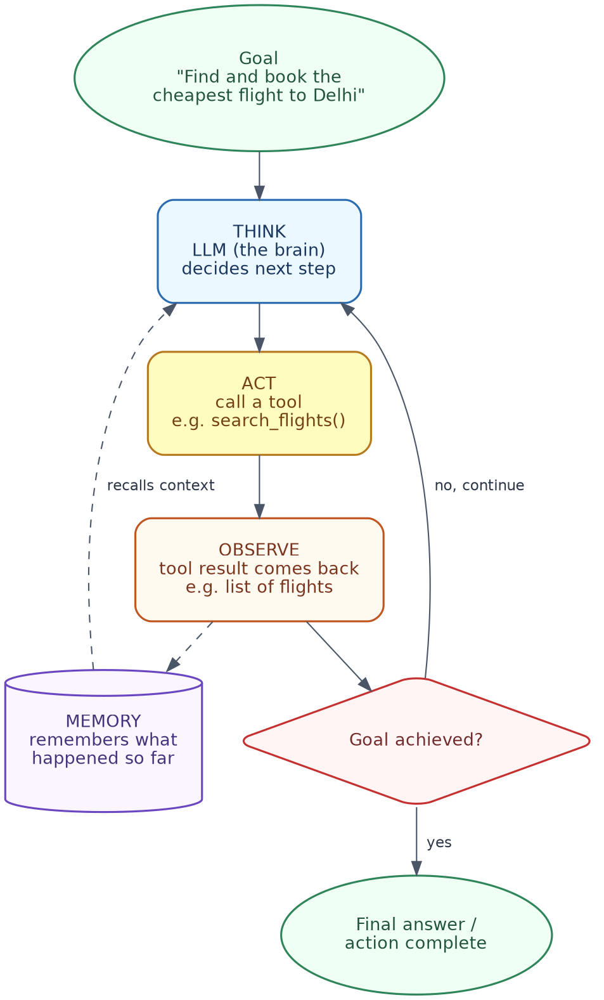
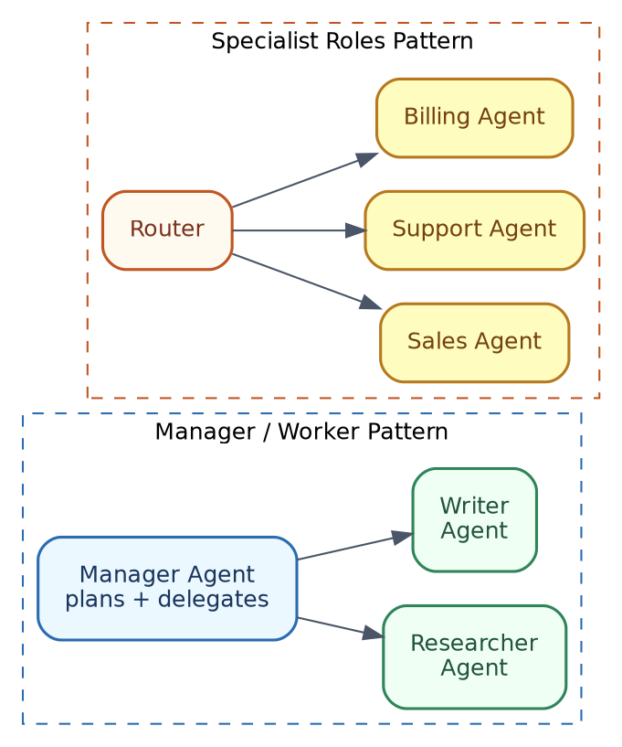

# Agentic AI Handbook


## 1. What is Agentic AI? (Quick Recap and Why It Is Important)

A normal chatbot only generates text. An **agent** goes one step further — it can actually take actions, like calling an API, searching the web, or running some code, to complete a task.


### Chatbot vs. Agent

| | Chatbot | Agent |
|---|---|---|
| **Can it look things up?** | No, only uses what it already knows | Yes, it can call outside tools |
| **Can it take real actions?** | No | Yes (send an email, book something, query a database, and so on) |
| **Example** | "Delhi is the capital of India" (from memory) | "Let me check today's weather in Delhi" (calls a real weather tool) |

**Why this matters:** A chatbot is basically a good talker. An agent is a good doer. Once an LLM can decide *when* and *how* to call tools on its own, it stops being just a text generator, and starts becoming something that can complete real, multi-step tasks for you.

### In terms of tools you already know

- **ChatGPT (plain chat)** answering "what is the capital of France" from memory is a **chatbot** moment. ChatGPT with browsing turned on, actually searching the web for today's news, is behaving like an **agent**.
 
- **Cursor / Claude Code** is a very good everyday example of an agent. When you ask it to "fix this bug," it does not just describe the fix in words — it actually opens the file, reads the code, edits it, and can even run your tests. That is the whole chatbot-to-agent shift, happening right inside your code editor.

---

## 2. Anatomy of an Agent

Every agent, no matter how simple or complex, is basically built from four parts, working together in a loop.


### Core Components of an AI Agent

1. **LLM (Large Language Model)** – Understands user requests, reasons, makes decisions, and determines the next action.

2. **Memory** – Stores conversation history and relevant information to maintain context and support future interactions.

3. **Tools** – Enable the agent to perform actions such as calling APIs, querying databases, searching the web, and executing code.

  

### The core loop: Think → Act → Observe → Repeat

1. **Think:** the LLM looks at the goal and the memory so far, and decides the next step.
2. **Act:** it calls a tool, with the arguments it thinks are correct.
3. **Observe:** the tool sends back a result.
4. **Repeat:** the LLM checks if the goal is complete. If not, it goes back to thinking, using this new information.

**Simple example:**
```
Goal: "Find and book the cheapest flight to Delhi."

Think:   I need current flight prices, which I do not have memorised.
Act:     search_flights(destination="Delhi")
Observe: a list of flights with prices comes back
Think:   the cheapest one is flight AI202 at ₹6,200
Act:     book_flight(flight_id="AI202")
Observe: booking confirmed
Final:   "Booked! Flight AI202, ₹6,200, departs 9 AM."
```

---

## 3. Tool Use / Function Calling

This is the actual mechanism that lets an agent "act." The LLM is given a list of tools it is allowed to use, along with a description of what each tool does and what input it needs. The LLM then decides, on its own, when to call which tool, and with what arguments.

**Simple example of a tool definition (in plain words, not code):**
```
Tool name: get_weather
Description: Returns the current weather for a given city
Input needed: city (text)
```

When the user asks, "What is the weather in Mumbai," the LLM sees this tool is a good match, and calls it like this:
```
get_weather(city="Mumbai")
```

The tool runs, returns a result like "29°C, humid," and this result is fed back to the LLM, so it can form a proper, final answer.

**This connects directly with MCP (Model Context Protocol):** if you have read the MCP Handbook, you will notice this is exactly the same idea — an LLM deciding to call a tool, getting back a structured result, and using it in its final answer. MCP simply standardises *how* those tools are described and exposed to the model. This section (function calling) is about the model *deciding* to use them.

---

## 4. Planning and Task Decomposition

Some tasks are simple enough for one tool call. Others need to be broken down into smaller steps first — this is called **task decomposition**.

### Single-step vs. multi-step agents

| Type | What it does | Example |
|---|---|---|
| **Single-step** | One question, one tool call, one answer | "What is the weather in Chennai?" → one weather tool call |
| **Multi-step** | Breaks a big goal into a series of smaller steps | "Plan a 3-day trip to Goa within ₹15,000" → needs flight search, hotel search, budget checking, all combined |

**Simple example of planning:**
```
Goal: "Plan a 3-day trip to Goa within ₹15,000."

Plan:
1. Search flights to Goa, note the price.
2. Search hotels in Goa for 3 nights, note the price.
3. Add both up, check if it is within ₹15,000.
4. If over budget, look for cheaper options and repeat step 3.
5. Present the final plan.
```

This planning step is what allows an agent to handle tasks a single prompt simply cannot manage in one shot.

---

## 5. Memory in Agents

Memory is what allows an agent to "remember" things, either within one task, or across many sessions.

| Type | What it remembers | Example |
|---|---|---|
| **Short-term memory** | What has happened so far, in the current task or conversation | Remembering that the user already said their budget is ₹15,000, without asking again |
| **Long-term memory** | Information saved and available across different sessions, even after the app is closed and reopened | Remembering a user's preferred seat type ("aisle seat") from a previous booking, weeks later |

**Why this matters:** Without memory, an agent would forget its own previous steps within the same task, and keep repeating tool calls, or asking the same questions again and again. Long-term memory is what makes an agent feel like it is actually "learning" your preferences over time, instead of starting from zero every single time.

**Simple example:**
```
Session 1: User says, "I prefer aisle seats."
           (saved in long-term memory)

Session 2 (next week): User says, "Book me a flight to Pune."
           Agent automatically books an aisle seat, without being asked again.
```

### In terms of tools you already know

- **Short-term memory** is what you already experience inside any single **ChatGPT** or **Claude** conversation — it remembers what you said 3 messages ago, without you repeating it.
- **ChatGPT's "Memory" feature** (remembering facts about you across different chats, like your job or preferences) is a real example of **long-term memory** in an everyday product.


---

## 7. Multi-Agent Systems

Sometimes, one agent trying to do everything is not the best design. Multi-agent systems split the work between several smaller, more focused agents.  



 No, Agent Reasoning Patterns and Multi-Agent Design Patterns are related, but they are not the same.

### 1. Agent Reasoning Patterns

Describe how an individual AI agent thinks through a problem and decides what to do next.

| Pattern          | How it works                                                        | Example                                                         |
| ---------------- | ------------------------------------------------------------------- | --------------------------------------------------------------- |
| ReAct            | Alternates between reasoning, taking action, and observing results. | Search for flights, review results, and search again if needed. |
| Plan-and-Execute | Creates a plan first, then executes the steps.                      | Plan research, collect information, and write a report.         |
| Reflection       | Reviews its own output and improves it.                             | Write code, review it, and fix mistakes.                        |
| Tool Calling     | Selects and invokes tools to complete a task.                       | Call a weather API to get current conditions.                   |

### 2. Multi-Agent Design Patterns

Describe how multiple agents are organized and collaborate to complete a task.

| Pattern                   | How it works                                  | Example                                                    |
| ------------------------- | --------------------------------------------- | ---------------------------------------------------------- |
| Manager / Worker          | A manager delegates tasks to worker agents.   | Researcher and Writer agents prepare a report.             |
| Specialist Roles / Router | Routes requests to specialized agents.        | Billing questions go to the Billing Agent.                 |
| Debate                    | Agents propose or critique different answers. | Two agents suggest solutions; a reviewer selects the best. |

### Key difference

* Reasoning patterns = How an agent solves a problem.

* Multi-agent design patterns = How agents work together.

You can combine them. For example, a Manager / Worker system can use ReAct within each worker agent and Reflection to review the final output.


---


## 9. Guardrails and Human-in-the-Loop


## 4.1 – Guardrails

Guardrails define the boundaries and safety rules that an AI agent must follow.

* **Permissions:** Specify which actions the agent is allowed to perform.

* **Limits:** Restrict spending, API usage, execution time, and retries.

* **Validation:** Check inputs and outputs to prevent invalid or unsafe actions.

* **Fallbacks:** Define what happens when a tool fails.

**Example:**

* Allowed: Search flights and check prices.

* Restricted: Payments above ₹10,000 require approval.

## 4.2 – Human-in-the-Loop (HITL)

Human-in-the-Loop allows a person to review, approve, reject, or modify an agent's actions at important decision points.

**Example:**

```
Agent: Ready to book flight AI202 for ₹6,200.
Proceed with booking? (Yes/No)
```

* **Approve:** The agent proceeds with the action.

* **Reject:** The agent stops the action.

* **Modify:** The human changes the details before proceeding.

**Real-world examples:**

* **Cursor:** Reviews code changes before accepting them.

* **Claude Code:** Can request permission before executing certain commands.

**Key difference:** Guardrails define what an agent can do; HITL lets a human intervene when approval or review is needed.


---

## 10. Common Mistakes to Avoid

| Mistake | What goes wrong | How to fix |
|---|---|---|
| **Infinite loops** | Agent keeps retrying a step, without making any real progress | Set a maximum number of steps, and stop cleanly if that limit is reached |
| **Tool misuse** | Agent calls a tool with wrong or malformed arguments | Give very clear tool descriptions; validate arguments before actually running the tool |
| **Cost and latency blowup** | Too many LLM calls happening per task, becoming slow and expensive | Track how many steps and tool calls are used; add limits where needed |
| **Over-trusting agent output** | Assuming the final answer is correct, without any human review | Add a review step for anything important, especially actions that cannot be undone |


---

## 12. Quick Hands-On Lab (Free Local LLM)

#### Lab overview: Goa trip agent with real flight and hotel prices

**Goal:** "Plan a 3-day trip to Goa within ₹15,000 from Hyderabad."
 The agent runs a think → act → observe loop. The local LLM only decides which tool to call next. Real prices come from SerpApi's Google Flights and Google Hotels, so the prices are not invented by the model.

| Part | What it is |
|---|---|
| Brain | Local LLM via Ollama (`gemma2:2b`) |
| Tool 1 | `search_flights`, which calls SerpApi's Google Flights for a real round-trip price |
| Tool 2 | `search_hotels`, which calls SerpApi's Google Hotels for a real 3-night total |
| Tool 3 | `check_budget`, which adds the two prices and says within or over budget |
| Memory | The `history` string, which grows each step |
| Guardrails | `max_steps`, no final answer before `check_budget` is called, and tool errors fed back to the LLM |


## Steps to implement

**1. Get a SerpApi key.** Sign up at serpapi.com. The free tier gives 250 searches/month, and one full run uses about 4 to 6.

**2. Set up the environment.**
```bash
pip install requests
export SERPAPI_KEY="your_key_here"
ollama pull gemma2:2b      # or keep using gemma2:2b
```


**3. Code - agentic_ai_goa_trip.py**
```
"""
agentic_ai_goa_trip.py — agent that plans a 3-day Goa trip within a budget,
using real prices from SerpApi and a free local LLM (Ollama).

Setup: pip install requests | export SERPAPI_KEY="..." | ollama serve
"""
import json, os, re
from datetime import date, timedelta
import requests

# --- Config ---
OLLAMA_URL = "http://localhost:11434/api/generate"
MODEL = "gemma2:2b"
SERPAPI_KEY = "copy_key_from_serp"
ORIGIN, DESTINATION = "HYD", "GOX,GOI"       # GOX = Mopa, GOI = Dabolim
NIGHTS, BUDGET = 3, 13000
CHECK_IN = (date.today() + timedelta(days=30)).isoformat()
CHECK_OUT = (date.today() + timedelta(days=30 + NIGHTS)).isoformat()


# --- Tools ---
def serp(params):
    data = requests.get("https://serpapi.com/search.json",
                        params={**params, "api_key": SERPAPI_KEY}, timeout=60).json()
    if "error" in data:
        raise RuntimeError(data["error"])
    return data


def search_flights(origin, destination, outbound_date, return_date, choice="best"):
    data = serp({"engine": "google_flights", "departure_id": origin, "arrival_id": destination,
                 "outbound_date": outbound_date, "return_date": return_date, "currency": "INR"})
    options = [o for o in data.get("best_flights", []) + data.get("other_flights", []) if "price" in o]
    if not options:
        return "No flights found."
    pick = min(options, key=lambda o: o["price"]) if choice == "cheapest" else options[0]
    leg = pick["flights"][0]
    return f"Flight ({choice}): {leg.get('airline')} {leg.get('flight_number', '')} - Rs {int(pick['price'])} round trip"


def search_hotels(city, check_in, check_out, choice="best"):
    nights = (date.fromisoformat(check_out) - date.fromisoformat(check_in)).days
    data = serp({"engine": "google_hotels", "q": f"hotels in {city}", "check_in_date": check_in,
                 "check_out_date": check_out, "adults": 1, "currency": "INR"})
    found = []
    for p in data.get("properties", []):
        total = (p.get("total_rate") or {}).get("extracted_lowest")
        if total is None and (p.get("rate_per_night") or {}).get("extracted_lowest"):
            total = p["rate_per_night"]["extracted_lowest"] * nights
        if total:
            found.append((p.get("name", "?"), total))
    if not found:
        return "No hotels found."
    name, total = min(found, key=lambda h: h[1]) if choice == "cheapest" else found[0]
    return f"Hotel ({choice}): {name} - Rs {int(total)} for {nights} nights"


def check_budget(flight_price, hotel_total, budget):
    total = float(flight_price) + float(hotel_total)      # a tool does the maths, not the LLM
    if total <= float(budget):
        return f"Total Rs {total:.0f} - WITHIN budget (Rs {float(budget) - total:.0f} left)"
    return f"Total Rs {total:.0f} - OVER budget by Rs {total - float(budget):.0f}"


TOOLS = {"search_flights": search_flights, "search_hotels": search_hotels, "check_budget": check_budget}

SYSTEM = """You are a travel-planning agent. Call one tool at a time.

Tools:
- search_flights(origin, destination, outbound_date, return_date, choice)  choice: "best" or "cheapest"
- search_hotels(city, check_in, check_out, choice)                         choice: "best" or "cheapest"
- check_budget(flight_price, hotel_total, budget)

Plan:
1. search_flights (best)  2. search_hotels (best)  3. check_budget
4. If OVER budget: search_flights and search_hotels with "cheapest", then check_budget again.
5. Give the final answer.

Reply with ONLY one JSON object:
{"tool": "<name>", "args": {...}}   or   {"final_answer": "Flight: ... Hotel: ... Total: ..."}
"""


# --- LLM ---
def call_llm(prompt):
    r = requests.post(OLLAMA_URL, json={"model": MODEL, "prompt": prompt, "stream": False,
                                        "format": "json", "options": {"temperature": 0}}, timeout=180)
    r.raise_for_status()
    return r.json()["response"]


def parse(text):
    m = re.search(r"\{.*\}", text, re.DOTALL)
    try:
        return json.loads(m.group(0)) if m else {}
    except json.JSONDecodeError:
        return {}


# --- Agent loop: think -> act -> observe ---
def run_agent(goal, max_steps=14):
    history = f"{SYSTEM}\nGoal: {goal}\n"
    done, price, over = set(), {}, False

    def pending():          # cheaper searches not tried yet
        return [t for t in ("search_flights", "search_hotels") if (t, "cheapest") not in done]

    for step in range(1, max_steps + 1):
        d = parse(call_llm(history))                                   # THINK

        if "final_answer" in d:
            if over and pending():                                     # guardrail: don't quit early
                print(f"  [guardrail] still over budget, {pending()[0]} (cheapest) not tried")
                history += f'\nSystem: Still over budget. Call {pending()[0]} with choice "cheapest" first.\n'
                continue
            print(f"\nFINAL ANSWER\n{d['final_answer']}")
            return d["final_answer"]

        if "tool" not in d or d["tool"] not in TOOLS:
            history += "\nSystem: Reply with ONE valid JSON object.\n"
            continue

        name, args = d["tool"], d.get("args") or {}
        if name == "check_budget":                                     # guardrail: use real latest prices
            args = {"flight_price": price.get("search_flights", 0),
                    "hotel_total": price.get("search_hotels", 0), "budget": BUDGET}
        try:
            result = TOOLS[name](**args)                               # ACT
        except Exception as e:
            result = f"Error: {e}"
        print(f"Step {step}: {name}({', '.join(f'{k}={v}' for k, v in args.items())})\n   -> {result}\n")  # OBSERVE

        if name != "check_budget":
            done.add((name, args.get("choice", "best")))
            m = re.search(r"Rs (\d+)", result)
            if m:
                price[name] = int(m.group(1))
        else:
            over = "OVER" in result
            if over and pending():
                history += f'\nSystem: Still over budget. Next call {pending()[0]} with choice "cheapest".\n'
        history += f"\nYou called: {json.dumps(d)}\nTool result: {result}\nNext step? JSON only.\n"

    print("Stopped: max_steps reached.")


if __name__ == "__main__":
    if not SERPAPI_KEY:
        raise SystemExit('Set your key first: export SERPAPI_KEY="your_key"')
    goal = (f"Plan a {NIGHTS}-day trip to Goa within Rs {BUDGET}. Fly {ORIGIN} to {DESTINATION} round trip "
            f"on {CHECK_IN}, returning {CHECK_OUT}. Hotel in Goa from {CHECK_IN} to {CHECK_OUT}.")
    print(f"GOAL: {goal}\n")
    run_agent(goal)``
```

**4. Run it.**

```bash
# Make sure Ollama is running
ollama serve

# Run Py file
python3 agentic_ai_goa_trip.py
```

```
python3 agentic_ai_goa_trip.py 
GOAL: Plan a 3-day trip to Goa within Rs 13000. Fly HYD to GOX,GOI round trip on 2026-11-11, returning 2026-11-14. Hotel in Goa from 2026-11-11 to 2026-11-14.

-----Loop:1---> It is tried for choice=best
Step 1: search_flights(origin=HYD, destination=GOI, outbound_date=2026-11-11, return_date=2026-11-14, choice=best)
   -> Flight (best): IndiGo 6E 887 - Rs 11497 round trip

Step 2: search_hotels(city=Goa, check_in=2026-11-11, check_out=2026-11-14, choice=best)
   -> Hotel (best): Moustache Goa Luxuria - Rs 5014 for 3 nights

Step 3: check_budget(flight_price=11497, hotel_total=5014, budget=13000)
   -> Total Rs 16511 - OVER budget by Rs 3511

-----Loop:2---> It is tried for choice=cheapest
Step 4: search_flights(origin=HYD, destination=GOI, outbound_date=2026-11-11, return_date=2026-11-14, choice=cheapest)
   -> Flight (cheapest): IndiGo 6E 887 - Rs 11497 round trip

Step 5: search_hotels(city=Goa, check_in=2026-11-11, check_out=2026-11-14, choice=cheapest)
   -> Hotel (cheapest): The Social Stays Goa Morjim - Rs 1056 for 3 nights

Step 6: check_budget(flight_price=11497, hotel_total=1056, budget=13000)
   -> Total Rs 12553 - WITHIN budget (Rs 447 left)


FINAL ANSWER
-------------
     Flight: IndiGo 6E 887 for Rs 11497,
     Hotel: The Social Stays Goa Morjim for Rs 1056,
     Total: Rs 12553
```


**Agent loop (`run_agent`), repeated up to 14 times**

1. **Set up memory:** `history` (the prompt plus the goal, growing each step), `done` (which searches have run), `price` (latest real prices), `over` (whether the last check was over budget).
2. **THINK:** send `history` to the LLM and parse its JSON reply.
3. **Decide what the reply is:**
   - **Final answer?** If the budget is still exceeded and a cheaper search hasn't been run, the code rejects it (guardrail 1) and tells the LLM what to do first. Otherwise it prints the answer and stops.
   - **Invalid or unknown tool?** Ask the LLM to reply again.
   - **Valid tool call?** Go to step 4.
4. **Prepare the tool call:** if the tool is `check_budget`, the code ignores the LLM's numbers and uses the real latest prices from `price` (guardrail 2).
5. **ACT:** run the chosen tool. If it fails, the error text becomes the result, so the loop doesn't crash.
6. **OBSERVE:** print `Step N: tool(args)` and the result.
7. **Update the state:**
   - After a search, record it in `done` and save the price in `price`.
   - After `check_budget`, set `over` to true or false. If over budget and a cheaper search is pending, add a nudge to `history` telling the LLM what to call next (guardrail 3).
8. **Remember:** append the tool call and its result to `history`, so the next round has full context.
9. **Repeat from step 2.**

---

## 13. Overview of Agentic AI Frameworks

This section gives a very simple, minimal, working example for each framework from Section 6 — a short introduction, how to install or access it, and a basic "hello world"-style example. These frameworks mostly work with paid LLM APIs (like OpenAI), so please keep that in mind while trying them out; a couple of them can also work with free local models with a small amount of extra setup, which is noted where relevant.

---

### 13.1 LangChain / LangGraph

LangChain helps you build the components that interact with an LLM, while LangGraph controls how those components execute in a stateful workflow or AI agent. They complement each other rather than compete.

### 1. What is LangChain?

LangChain is an open-source framework for building LLM-powered applications using models such as GPT, Llama, and Groq-hosted models.

It provides reusable components for prompts, model calls, tools, document retrieval, and output processing.

#### Core components

| Component        | Purpose                                            |
| ---------------- | -------------------------------------------------- |
| Chat Models      | Connect to LLMs (`ChatGroq`)                       |
| Prompt Templates | Create reusable prompts (`ChatPromptTemplate`)     |
| Output Parsing   | Validate and transform responses (Pydantic)        |
| Chains / LCEL    | Connect steps using <code>prompt \\\| model</code> |
| Tools            | Integrate Python functions and APIs (`@tool`)      |
| RAG              | Retrieve relevant information from documents       |
| Message History  | Maintain conversational context                    |

LangChain also supports document loading, text splitting, embeddings, vector stores, and retrieval.

### 2. What is LangGraph?

LangGraph is a framework for building stateful, multi-step workflows and AI agents using graphs.

Unlike a simple sequence, a graph can branch, loop, pause, and resume execution.

#### Core concepts

| Concept           | Purpose                                           |
| ----------------- | ------------------------------------------------- |
| `StateGraph`      | Defines the workflow                              |
| State             | Stores inputs, messages, and results              |
| Nodes             | Execute tasks such as LLM calls or business logic |
| Edges             | Define the execution path                         |
| Conditional Edges | Choose the next step based on a decision          |
| Checkpointer      | Saves state to support persistence and resumption |

LangGraph also supports streaming, human-in-the-loop approval, and subgraphs.

#### 3. LangChain vs LangGraph

| Area                 | LangChain                                | LangGraph                                |
| -------------------- | ---------------------------------------- | ---------------------------------------- |
| Primary role         | LLM application components               | Workflow and agent orchestration         |
| Main abstractions    | Models, prompts, tools, retrievers       | Graphs, nodes, edges, state              |
| Execution            | Chains and agent abstractions            | Explicit branching, looping, and routing |
| State                | Conversation history utilities           | Shared, evolving workflow state          |
| Persistence          | Depends on the component                 | Integrated checkpoint-based persistence  |
| Human approval       | Implement through application logic      | Supports interrupt and resume            |
| Best suited for      | Direct LLM tasks and reusable components | Complex, stateful workflows              |
| Works independently? | Yes                                      | Yes; LangChain components are optional   |

Important: LangChain also supports agents and complex applications. LangGraph provides more explicit control over execution, state, and workflow transitions.


**4. When to Use?**

**LangChain:** Chatbots, summarization, RAG, structured output, and API integration.

**LangGraph:** Multi-step agents, conditional workflows, human approval, persistence, and multi-agent systems.

**How to install:**
```bash
pip install langgraph langchain langchain-openai
export OPENAI_API_KEY=sk-...
```

**Minimal example:**
```python
from langgraph.prebuilt import create_react_agent
from langchain_openai import ChatOpenAI

def get_weather(city: str) -> str:
    """Get the current weather for a city."""
    return f"It's sunny in {city}."

model = ChatOpenAI(model="gpt-4o")
agent = create_react_agent(model, tools=[get_weather])

result = agent.invoke({"messages": [{"role": "user", "content": "What's the weather in Pune?"}]})
print(result["messages"][-1].content)
```

**Note:** LangGraph is model-agnostic, so if you want to try it with a free, local model instead, you can swap `ChatOpenAI` for an Ollama-compatible chat model from the `langchain-ollama` package.

---


### 13.2 CrewAI

CrewAI is an open-source framework for building AI agent systems where multiple specialized agents collaborate to complete tasks.

Core concepts:

* Agents: AI workers with specific roles and goals.

* Tasks: Work assigned to agents.

* Crews: Teams of agents collaborating on tasks.

* Flows: Define workflows and control execution.

* Tools: Enable agents to use APIs, search, and other functions.

Example: A Research Agent gathers information, a Writer Agent creates a report, and a Reviewer Agent checks the result.

#### 2. CrewAI vs LangChain

| Feature             | CrewAI                                  | LangChain                                    |
| ------------------- | --------------------------------------- | -------------------------------------------- |
| Primary purpose     | Build collaborative AI agent teams      | Build LLM applications                       |
| Main focus          | Agent roles and collaboration           | Models, prompts, tools, RAG, and chains      |
| Core concepts       | Agents, Tasks, Crews, Flows             | Models, Prompts, Runnables, Tools            |
| Multi-agent support | Built around agent collaboration        | Supports agents and multi-agent integrations |
| Workflow control    | Crews and Flows                         | Chains and agent abstractions                |
| Best suited for     | Role-based, collaborative agent systems | General-purpose LLM applications             |

#### 3. When to use each?

* CrewAI: When multiple specialized agents need to collaborate, such as researching, writing, and reviewing.

* LangChain: When building chatbots, RAG applications, API integrations, or individual AI agents.

Remember: LangChain provides LLM application building blocks; CrewAI focuses on coordinating AI agents that work together.


**How to install:**
```bash
pip install crewai
export OPENAI_API_KEY=sk-...
```

**Minimal example:**
```python
from crewai import Agent, Task, Crew

researcher = Agent(
    role="Researcher",
    goal="Find interesting facts about a topic",
    backstory="An experienced research analyst.",
)

research_task = Task(
    description="Find 3 interesting facts about the Taj Mahal.",
    expected_output="A short list of 3 facts.",
    agent=researcher,
)

crew = Crew(agents=[researcher], tasks=[research_task])
result = crew.kickoff()
print(result)
```

**Note:** CrewAI requires Python 3.10 or newer (and currently below 3.14). The project recommends using the `uv` tool for dependency management, though plain `pip install crewai` also works for simple use.

---


### 13.3 OpenAI Agents SDK

**High-level intro:** This is OpenAI's own official, lightweight framework for building agents, complete with built-in support for tools, handoffs (delegating to other specialist agents), guardrails, and memory ("sessions") — with minimal setup needed.

**How to install:**
```bash
pip install openai-agents
export OPENAI_API_KEY=sk-...
```

**Minimal example:**
```python
from agents import Agent, Runner

agent = Agent(
    name="Assistant",
    instructions="You are a helpful assistant.",
)

result = Runner.run_sync(agent, "Write a haiku about the Ganges river.")
print(result.final_output)
```

**Note:** The SDK is provider-agnostic in design, meaning it can also work with 100+ other LLMs beyond OpenAI's own models, though the simplest path (shown above) uses an OpenAI API key directly.

---

### 13.4 Microsoft AutoGen (AgentChat)

**High-level intro:** AutoGen, from Microsoft Research, is built around the idea of agents having a "conversation" with each other (or with a human) to solve a task. The current recommended starting point is its high-level **AgentChat** API.

**How to install:**
```bash
pip install -U autogen-agentchat "autogen-ext[openai]"
export OPENAI_API_KEY=sk-...
```

**Minimal example:**
```python
import asyncio
from autogen_agentchat.agents import AssistantAgent
from autogen_ext.models.openai import OpenAIChatCompletionClient

async def main():
    model_client = OpenAIChatCompletionClient(model="gpt-4o")
    agent = AssistantAgent("assistant", model_client)
    result = await agent.run(task="Say 'Namaste, World!'")
    print(result)

asyncio.run(main())
```

**Note:** AutoGen also has a no-code option called AutoGen Studio (`pip install autogenstudio`, then `autogenstudio ui`), which gives you a browser-based UI to build and test agent teams without writing any Python code.

### 13.5 AutoGPT

**High-level intro:** AutoGPT was one of the very first fully autonomous agent frameworks. Today, it exists mainly as a **hosted platform** with a visual, drag-and-drop "Agent Builder," rather than something you typically use as a small Python library like the others in this list. It also still has an open-source, self-hostable core for developers who want full control.

**How to access:**
- **Easiest way:** go to the hosted AutoGPT platform, sign up, and use the visual Agent Builder to create an agent by connecting blocks — no coding required.
- **Self-hosted way (for developers):** clone the project from GitHub, and run it using Docker, following the setup instructions in the repository.

```bash
git clone https://github.com/Significant-Gravitas/AutoGPT.git
cd AutoGPT
# follow the project's own setup guide for Docker-based self-hosting
```

**How to use (conceptually, since this is not a simple code snippet like the others):**
1. Open the Agent Builder (hosted) or your self-hosted instance.
2. Give your agent a goal in plain language, for example, "Research the top 5 laptops under ₹50,000 and summarise them."
3. Connect the blocks you need (web search, summarise, and so on) in the visual builder, or let a template do this for you.
4. Run the agent, and review its output and steps.

**Note:** Because AutoGPT has shifted towards being a full platform rather than a lightweight library, it is a bit different from the other four frameworks here — it is worth trying through its hosted builder first, before attempting to self-host it.

---


 ### Quick Comparison of Agentic AI Frameworks — Recommended Learning Order

| Framework              | Lines of Code (Roughly)                 | Detailed Description / Best First Impression                                                                                                                                                                                |
| ---------------------- | --------------------------------------- | --------------------------------------------------------------------------------------------------------------------------------------------------------------------------------------------------------------------------- |
| 1. LangChain           | ~5–10                                   | Learn the fundamentals of LLM application development, including model integration, prompt templates, output parsing, tools, chains, and RAG. Ideal for building chatbots and applications connected to APIs and documents. |
| 2. LangGraph           | ~10–20                                  | Build stateful AI agents and workflows with nodes, edges, conditional routing, loops, checkpointing, and human approval. Ideal for complex, multi-step processes requiring control over execution.                          |
| 3. CrewAI              | ~15–30                                  | Create teams of specialized AI agents with defined roles, goals, and tasks. Learn how agents collaborate, delegate work, and coordinate through Crews and Flows. Ideal for research, writing, and review pipelines.         |
| 4. OpenAI Agents SDK   | ~8–15                                   | Build agents with instructions, tools, handoffs between specialized agents, guardrails, and execution tracing. Ideal for lightweight agent development using OpenAI's SDK.                                                  |
| 5. AutoGen (AgentChat) | ~10–20                                  | Build multi-agent applications where agents exchange messages, collaborate on problems, and coordinate tasks. Ideal for experimenting with conversational agent teams and research-style workflows.                         |
| 6. AutoGPT             | ~0 with visual interface; coding varies | Explore goal-driven task automation through an agent platform. Learn how AI can plan and execute tasks, use tools, and automate multi-step objectives with minimal manual intervention, depending on the platform setup.    |

