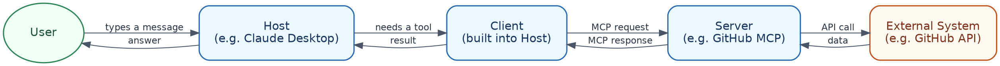
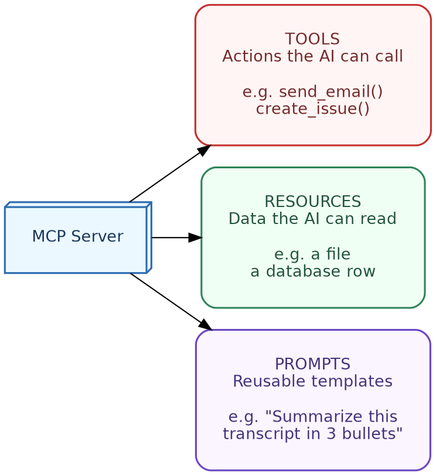
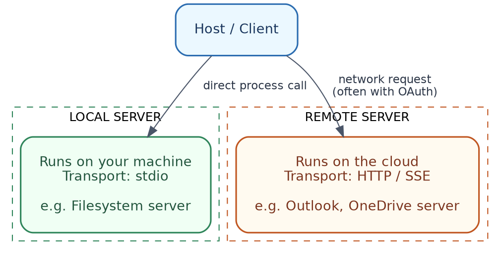
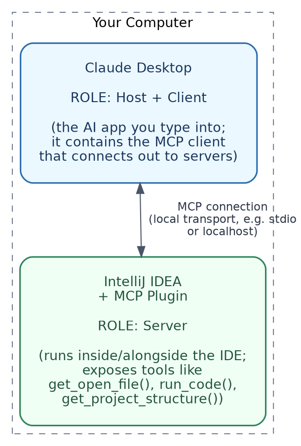
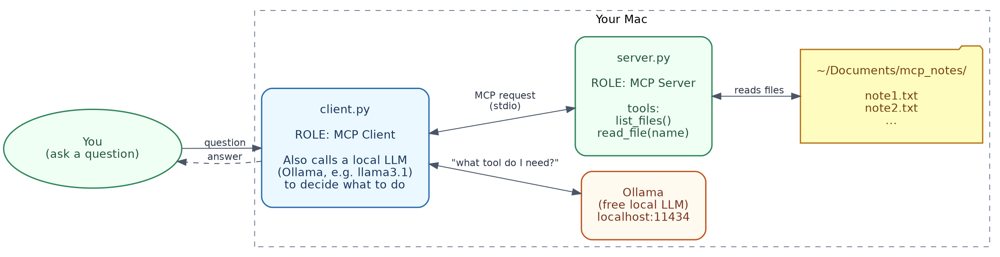

# The MCP Handbook (Short Edition)
### A simple guide to the Model Context Protocol

---

## Table of Contents

1. What is MCP?
2. Why MCP Was Created
3. Core Building Blocks
4. Client vs Server
5. What Servers Provide
6. How Communication Works
7. MCP Across Apps
8. Your Setup: Claude Desktop + IntelliJ
9. Popular MCP Servers
10. Setting Up Your First Server
11. Security Basics
12. Troubleshooting
13. Hands-On Lab: Client + Server with a Free LLM
14. Where to Go Next

---

## 1. What is MCP?

**MCP (Model Context Protocol)** is an open standard that lets AI apps (Claude, ChatGPT, Cursor, IDEs) connect to external tools, files and data in one consistent way.

**Analogy: USB-C for AI.** Before USB-C, every device needed its own cable. With MCP, a GitHub server built once works in Claude, Cursor or any MCP-compatible app, with no rewriting.

> **Definition:** MCP is a shared set of rules that lets an AI model ask an external program for tools, data or prompt templates.

**Example:** You ask Claude, "What's the weather in Tokyo?" Claude has no live data, so it calls a Weather MCP server's `get_weather` tool, gets the result and answers.

You've already seen this pattern: when Claude or ChatGPT searches the web, or Cursor reads your codebase, it is reaching out to a tool. MCP standardises that connection.

---

## 2. Why MCP Was Created

**The N×M problem.** With N AI apps and M tools, you'd need a custom integration for every pair: N × M integrations.

**The fix.** Each tool builds **one** MCP server, and each app builds **one** MCP client. Now any app can use any tool: **N + M** integrations.

**Example:** GitHub builds one server. Claude Desktop, Cursor and IntelliJ each add MCP client support once. All three can now use GitHub.

**Other goals:**
- Open standard, not owned by one company
- Security and user consent built in
- Works locally (your machine) and remotely (internet)
- Simple enough for hobby tools, robust enough for enterprises

---

## 3. Core Building Blocks

| Role | What it is | Example |
|---|---|---|
| **Host** | The AI app the user talks to | Claude Desktop, Cursor, ChatGPT |
| **Client** | Connector inside the host that talks to a server | Built into the host |
| **Server** | Program that exposes tools, data or prompts | GitHub server, Filesystem server |



**Example:** "List my open GitHub issues."
- Host = Claude Desktop
- Client = MCP connector inside Claude Desktop
- Server = GitHub MCP server, which calls GitHub's API for you

---

## 4. Client vs Server

**Client:**
- Lives inside the host
- Discovers what a server offers (*capability discovery*)
- Sends requests ("call this tool with these arguments")
- Passes results to the AI model
- Manages the connection (open, close, reconnect)

**Server:**
- Exposes **tools**, **resources** and **prompts**
- Validates requests
- Runs the real logic (query a DB, read a file)
- Returns structured results

**Trust and permissions:**
- The **host** asks the **user** before a tool runs ("Allow Claude to read this file?")
- The **server** does only what it is scoped for (a read-only server never deletes)
- The **client** treats server output as untrusted data

**Example conversation:**
1. Client: "Do you have `search_issues`?"
2. Server: "Yes. It takes a `query` string and returns issues."
3. Client: "Run it with query = 'bug'."
4. Server: returns 5 issues.
5. Client: hands them to the model to summarise.

Cursor's "Allow this command?" prompt is exactly this permission step.

---

## 5. What Servers Provide

| Type | Purpose | Example |
|---|---|---|
| **Tool** | Perform an action (like a function) | `send_email()`, `create_github_issue()` |
| **Resource** | Read-only data | `file:///project/README.md`, `github://repo/issues/42` |
| **Prompt** | Reusable instruction template | "Review this diff and check for bugs" |



In Cursor: reading a project file uses a **resource**; editing a file or running a command calls a **tool**.

---

## 6. How Communication Works

MCP messages use **JSON-RPC 2.0**, a simple request/response format.

**Request:**
```json
{
  "jsonrpc": "2.0",
  "id": 1,
  "method": "tools/call",
  "params": { "name": "get_weather", "arguments": { "city": "Tokyo" } }
}
```

**Response:**
```json
{
  "jsonrpc": "2.0",
  "id": 1,
  "result": { "temperature": "24°C", "condition": "Cloudy" }
}
```

**Transports:**

| Type | Transport | Example |
|---|---|---|
| Local | stdio (standard input/output) | Filesystem server on your machine |
| Remote | HTTP / Server-Sent Events (SSE) | Cloud-hosted GitHub or Slack server |



**Lifecycle:**
1. Host starts the server (local) or connects to it (remote).
2. **Handshake**: both sides share supported capabilities.
3. Client asks, "What tools do you have?"
4. Server returns tools with input/output schemas.
5. Client calls a tool when needed; server runs it and returns the result.

The "using tool..." indicator in Claude or Cursor is this exchange happening.

---

## 7. MCP Across Apps

| App | Uses MCP? | How to connect | Typical use |
|---|---|---|---|
| **Claude Desktop** | Yes, natively | `claude_desktop_config.json` | Filesystem, local notes |
| **Cursor** | Yes, natively | Similar JSON config in settings | GitHub, database, docs |
| **IntelliJ / JetBrains** | Yes, via plugin | Plugin settings or config file | Project context inside the IDE |
| **ChatGPT** | Partially; mainly its own Connectors/Actions, with MCP support growing | Connector settings | Internal company tools |

**Config example (Claude Desktop and Cursor use the same shape):**
```json
{
  "mcpServers": {
    "filesystem": {
      "command": "npx",
      "args": ["-y", "@modelcontextprotocol/server-filesystem", "/Users/you/Documents"]
    }
  }
}
```
Restart the app. It launches the server, does the handshake, and the tools appear in chat with a permission prompt before anything runs.

**Notes:**
- **Cursor:** often connected to a DB or GitHub so the AI checks real schemas or issues before writing code.
- **IntelliJ:** the plugin exposes open files and project structure as MCP tools.
- **ChatGPT:** similar idea (structured tool calls + permissions) but not always literally MCP. It changes fast, so check current docs.

---

## 8. Your Setup: Claude Desktop + IntelliJ

**Key idea:** both apps run **on your computer** and talk locally. Nothing goes to a remote server for this connection.

| Component | MCP role | What it does |
|---|---|---|
| **Claude Desktop** | Host + Client | Where you type; its client connects to servers |
| **IntelliJ + MCP plugin** | Server | Exposes IDE tools: read open file, browse project, run code |
| **You** | User | Ask questions and approve permission prompts |

**Why this way?** IntelliJ already knows your project (files, structure, run configs, code index). The plugin exposes that as tools, so Claude asks for exactly what it needs instead of guessing.

**Flow:**
1. You ask, "What does `UserService` do?"
2. Claude Desktop's client sends a request.
3. The IntelliJ plugin runs a tool such as `get_file_contents` on your open project.
4. The result goes back to Claude Desktop.
5. Claude answers using your real code.

The connection uses a **local transport** (like stdio/local socket). The cloud is involved only if you also add remote servers such as Outlook or OneDrive.



**Verify it:**
- IntelliJ plugin panel shows "MCP server running" with a port/status.
- Claude Desktop → Settings → Developer/MCP lists IntelliJ and its tools.
- An accurate answer about your open project confirms it works.

---

## 9. Popular MCP Servers

| Server | Common tools | Example question | Safety note |
|---|---|---|---|
| **GitHub** | `search_issues`, `create_issue`, `list_pull_requests`, `get_file_contents` | "Create an issue titled 'Fix login bug'" | Scope to specific repos |
| **Filesystem** | `read_file`, `write_file`, `list_directory`, `search_files` | "Summarise my notes in `Notes/2026`" | Set a specific root folder |
| **PostgreSQL** | `list_tables`, `describe_table`, `run_query` | "Orders placed last month?" | Read-only; block INSERT/UPDATE/DELETE |
| **Outlook** | `list_emails`, `send_email`, `create_calendar_event`, `search_emails` | "Find my manager's Q3 budget email" | OAuth; confirm before sending |
| **OneDrive** | `list_files`, `read_file`, `search_files`, `upload_file` | "Pull the budget from my latest proposal" | Same care as Filesystem |

**Same pattern for all:** the AI calls a tool, e.g. `create_issue(repo="web-app", title="Fix login bug")`, the server does the work via that system's API, and the result comes back to chat.

---

## 10. Setting Up Your First Server

**1. Install**
```bash
pip install mcp
```

**2. Write a tool** (`calculator_server.py`)
```python
from mcp.server.fastmcp import FastMCP

mcp = FastMCP("Calculator Server")

@mcp.tool()
def add(a: int, b: int) -> int:
    """Add two numbers together."""
    return a + b

if __name__ == "__main__":
    mcp.run()
```

**3. Run it**
```bash
python calculator_server.py
```

**4. Add to the host config**
```json
{
  "mcpServers": {
    "calculator": {
      "command": "python",
      "args": ["/path/to/calculator_server.py"]
    }
  }
}
```

**5. Test.** Restart the host and ask "What's 42 plus 58?" The AI should call `add` and return 100.

---

## 11. Security Basics

MCP servers take real actions (send email, delete files, run SQL), so mistakes or malicious input can cause real harm.

**Key practices:**
- **User approval:** hosts confirm before a tool runs (first time or every time).
- **Least access:** give only what's needed, e.g. one folder or read-only DB.
- **Don't trust output:** data from servers, especially web pages or emails, may hide instructions (**prompt injection**).
- **Authentication:** remote servers use OAuth, not shared passwords.

**Example risk:** a Filesystem server with write access to your whole drive could overwrite important files after one bad prompt. Scoping to one folder limits the damage.

Cursor showing a diff before applying changes, and Claude asking before a tool runs, are this security model working as designed.

---

## 12. Troubleshooting

**MCP Inspector** is the official tool for testing servers without a host app. Use it to:
- See a server's tools, resources and prompts
- Send test requests and view raw responses
- Catch schema errors early

| Error | Likely cause | Fix |
|---|---|---|
| Server won't start | Wrong command/path | Check config paths |
| "Tool not found" | Cached old capability list | Restart the host |
| Permission denied | Scope too narrow or missing OAuth | Check config, re-authenticate |
| Timeout | Server hangs or slow API | Add logging to find the stall |
| JSON parse error | Malformed server response | Match output to the expected schema |

---

## 13. Hands-On Lab: Client + Server with a Free LLM (Mac, Python)

You'll build a **server** that gives read-only access to a folder of `.txt` files, and a **client** that connects a **free local LLM** ([Ollama](https://ollama.com)) to it. No API keys, no cost.



- `server.py`: exposes `list_files()` and `read_file(filename)`, scoped to one folder
- `client.py`: launches the server, asks the LLM, runs tool calls, prints the answer
- **Ollama**: runs a free model (e.g. `llama3.1`) locally

### Step 1: Install

```bash
pip install mcp requests
brew install ollama
ollama pull llama3.1        # any tool-calling model works
```
Ollama serves the model at `http://localhost:11434`.

### Step 2: Create notes

```bash
mkdir -p ~/Documents/mcp_notes
echo "Grocery list: eggs, milk, spinach, coffee." > ~/Documents/mcp_notes/note1.txt
echo "Project idea: build a home budget tracker in Python." > ~/Documents/mcp_notes/note2.txt
```
The AI can only see files in this folder.

### Step 3: Server (`server.py`)

```python
import os
from pathlib import Path
from mcp.server.fastmcp import FastMCP

# The only folder the AI can read from
ALLOWED_DIR = Path(os.path.expanduser("~/Documents/mcp_notes")).resolve()
ALLOWED_DIR.mkdir(parents=True, exist_ok=True)

mcp = FastMCP("Notes Folder Server")


@mcp.tool()
def list_files() -> list[str]:
    """List all .txt files available in the notes folder."""
    return [f.name for f in ALLOWED_DIR.glob("*.txt")]


@mcp.tool()
def read_file(filename: str) -> str:
    """Read the full contents of one .txt file from the notes folder.

    Args:
        filename: the name of the file, e.g. 'note1.txt'
    """
    target = (ALLOWED_DIR / filename).resolve()

    # Safety check: never allow escaping the allowed folder
    if not str(target).startswith(str(ALLOWED_DIR)):
        return "Error: access outside the notes folder is not allowed."
    if not target.exists():
        return f"Error: '{filename}' was not found in the notes folder."

    return target.read_text(encoding="utf-8", errors="ignore")


if __name__ == "__main__":
    mcp.run()
```

**Why the safety check?** Without it, `filename="../../../etc/passwd"` could read files outside the folder. Always validate paths.

### Step 4: Client (`client.py`)

```python
import asyncio
import requests
from mcp import ClientSession, StdioServerParameters
from mcp.client.stdio import stdio_client

OLLAMA_URL = "http://localhost:11434/api/chat"
MODEL = "llama3.1"


def mcp_tool_to_ollama_tool(tool) -> dict:
    """Convert an MCP tool definition into Ollama's format."""
    return {
        "type": "function",
        "function": {
            "name": tool.name,
            "description": tool.description or "",
            "parameters": tool.inputSchema,
        },
    }


async def main():
    question = input("Ask something about your notes folder: ")

    # 1. Launch server.py and connect over stdio
    server_params = StdioServerParameters(command="python3", args=["server.py"])

    async with stdio_client(server_params) as (read, write):
        async with ClientSession(read, write) as session:
            await session.initialize()

            # 2. Discover the server's tools
            tools_response = await session.list_tools()
            ollama_tools = [mcp_tool_to_ollama_tool(t) for t in tools_response.tools]

            messages = [
                {"role": "system", "content": (
                    "You can answer questions about text files using the provided "
                    "tools. Always call list_files first if you are not sure which "
                    "file to read.")},
                {"role": "user", "content": question},
            ]

            # 3. Ask the LLM, offering the MCP tools
            response = requests.post(
                OLLAMA_URL,
                json={"model": MODEL, "messages": messages, "tools": ollama_tools, "stream": False},
                timeout=120,
            ).json()
            msg = response["message"]

            # 4. Run any requested tools through the MCP server
            if msg.get("tool_calls"):
                messages.append(msg)
                for call in msg["tool_calls"]:
                    tool_name = call["function"]["name"]
                    tool_args = call["function"]["arguments"]
                    print(f"  -> calling MCP tool: {tool_name}({tool_args})")
                    result = await session.call_tool(tool_name, tool_args)
                    messages.append({"role": "tool", "content": result.content[0].text})

                # 5. Send results back for the final answer
                final = requests.post(
                    OLLAMA_URL,
                    json={"model": MODEL, "messages": messages, "stream": False},
                    timeout=120,
                ).json()
                print("\n" + final["message"]["content"])
            else:
                print("\n" + msg["content"])  # answered without tools


if __name__ == "__main__":
    asyncio.run(main())
```

### Step 5: Run

```bash
python3 client.py
```
Try:
- "What files do I have?" → calls `list_files()`
- "What's on my grocery list?" → calls `list_files()`, then `read_file("note1.txt")`

### How it maps to MCP

| Piece | MCP role | Section |
|---|---|---|
| `client.py` | Client (and Host, since no app wraps it) | 3–4 |
| `server.py` | Server | 3–5 |
| `list_files`, `read_file` | Tools | 5 |
| stdio link | Local transport | 6 |
| `startswith` check | Scoping / security | 11 |
| Ollama | The LLM "brain"; not part of MCP itself | — |

### Tips

- Model too big? Use a smaller tool-calling model; just change `MODEL`.
- No tool calls? Check that your model supports tool/function calling.
- No agent framework is used on purpose, so you see every request. Add `print(response)` to inspect raw JSON.
- Ollama and MCP SDK APIs change; check current docs if a call fails.
- Claude Desktop and Cursor follow this same pattern, wrapped in a full app.

---

## 14. Where to Go Next

**Resources:** official MCP docs and spec, SDKs (Python, TypeScript and more), and official example servers (Filesystem, GitHub, Postgres).

**Learning path:**
1. Connect an existing server (Filesystem or GitHub) in Claude Desktop or Cursor.
2. Explore a server's tools with MCP Inspector.
3. Build a minimal server (the calculator).
4. Add a real tool: weather API, to-do list or DB query.
5. Learn security scoping and OAuth.

**Practice projects:**
- Notes server that reads/writes a markdown folder
- Task tracker backed by SQLite
- Weather server wrapping a public API

**Final thought:** if you use ChatGPT, Claude or Cursor, you already use MCP-style patterns. This handbook just shows what happens behind the scenes.

---

*End of Handbook*
